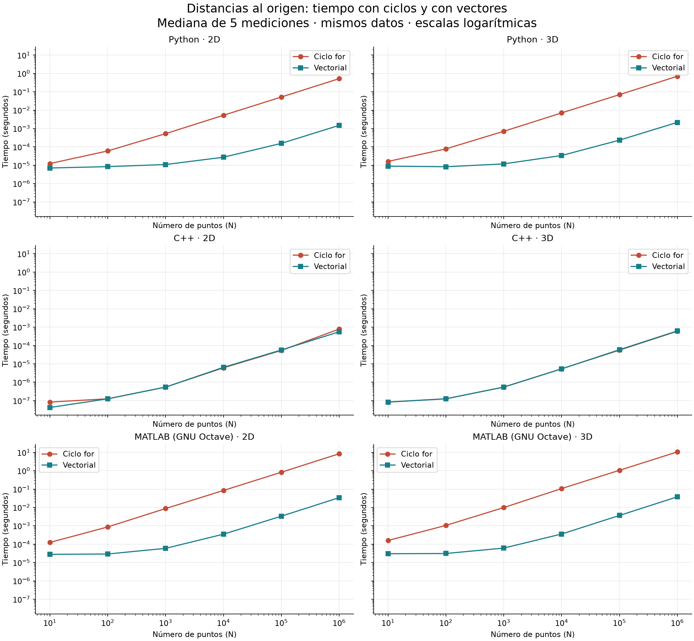
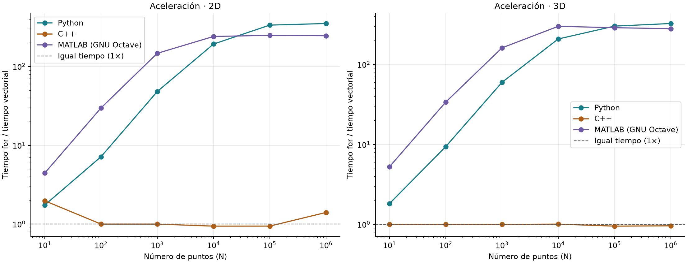

# Ejercicio 2 — Comparación escalar y vectorial en 2D y 3D

## Objetivo y entrega
Comparar dos formas de calcular las distancias al origen de 10, 100, 1 000, 10 000, 100 000 y 1 000 000 de puntos, en dos y tres dimensiones, en **Python, C++ y lenguaje MATLAB**. Hay 36 combinaciones de lenguaje, dimensión y tamaño; cada una incluye ambos métodos, con cinco repeticiones por método: **360 mediciones**, además de los calentamientos.

El programa `.m` se ejecutó con **GNU Octave**, un entorno compatible con gran parte del lenguaje MATLAB. Sus tiempos se identifican como “MATLAB (GNU Octave)”: no son mediciones del producto MATLAB. Para obtener tiempos de MATLAB, ejecutar el mismo archivo allí y regenerar las gráficas. El rendimiento de su compilador JIT puede ser muy distinto.

## 1. Fórmula matemática
La distancia se obtiene aplicando el teorema de Pitágoras:

- En 2D: `d = sqrt(x² + y²)`.
- En 3D: `d = sqrt(x² + y² + z²)`.

Por ejemplo, `(3,4)` está a distancia 5 y `(3,4,12)` está a distancia 13. No se calculan distancias entre pares de puntos.

## 2. Procedimiento
1. Python genera tres vectores de un millón de coordenadas uniformes en `[0,100)`, con `default_rng(42)`, y los exporta. Para cada N se toman las primeras N coordenadas; 2D utiliza x e y, y 3D agrega z.
2. C++ y MATLAB leen exactamente los mismos números. El archivo `coordenadas.bin` contiene tres bloques (x, y, z), cada uno con 1 000 000 de float64 little-endian. Pesa 24 000 000 bytes. Se evita generar datos distintos con semillas de otros lenguajes.
3. La versión escalar reserva un vector de resultados y aplica la fórmula a cada punto dentro de un `for`.
4. La versión vectorial aplica operaciones algebraicas a los arreglos completos. No contiene ciclos explícitos ni utiliza una función especializada que calcule la distancia.
5. Para cada combinación se calientan ambas funciones una vez. Después se miden cinco ejecuciones de cada método, alternando el orden de ejecución.
6. Se verifica cada resultado fuera del cronómetro. Se obtiene la mediana de las cinco duraciones y la aceleración `mediana_for / mediana_vectorial`.
7. Se reúnen los CSV y se grafican los tiempos y las aceleraciones.

Los bucles para recorrer tamaños, dimensiones y repeticiones son parte del experimento; los que se eliminan son los del cálculo vectorial de distancias.

## 3. De ciclos a sintaxis algebraica

| Lenguaje | Expresión vectorial 2D | Expresión vectorial 3D |
|---|---|---|
| Python / NumPy | `np.sqrt(x**2 + y**2)` | `np.sqrt(x**2 + y**2 + z**2)` |
| C++ / Eigen | `(x.square() + y.square()).sqrt().eval()` | `(x.square() + y.square() + z.square()).sqrt().eval()` |
| MATLAB / Octave | `sqrt(x.^2 + y.^2)` | `sqrt(x.^2 + y.^2 + z.^2)` |

En cada posición i, las expresiones vectoriales calculan exactamente la fórmula del ciclo. Python aplica `**2` elemento a elemento a arreglos NumPy. Eigen utiliza `ArrayXd` (arreglos de double) y `square()`. En MATLAB, `.^` es potencia elemento a elemento; `^` es potencia matricial. La suma y la raíz cuadrada se aplican a cada posición.

## 4. Cronometría y validación
- Python utiliza `time.perf_counter()`; C++ utiliza `std::chrono::steady_clock`; MATLAB/Octave utiliza `tic/toc`.
- Se incluyen la creación del resultado y los temporales del cálculo. Se excluyen generación, lectura/escritura de archivos, selección de datos, comprobaciones, impresiones y gráficas.
- Se verifica tamaño, precisión double/float64 y que las entradas se conserven. En C++, `ArrayXd` fija el tipo double; las funciones reciben las entradas como referencias constantes.
- Se prueban puntos conocidos, coordenadas negativas, el origen y arreglos vacíos. Todos los resultados de cada ejecución se comparan con la referencia escalar, no únicamente una muestra.
- La tolerancia es `abs(resultado - referencia) <= 1e-12 + 1e-12 * abs(referencia)`. En Python se aplica `np.testing.assert_allclose`.
- La validación consume el resultado de C++, evitando que todo el cálculo sea descartado por no utilizarse. Se compiló con optimización `-O3`, sin `-ffast-math`.

Los tiempos de N pequeño incluyen costos de llamada, reserva y cronómetro; pueden fluctuar o no crecer de forma monótona. Cinco repeticiones describen esta ejecución, no constituyen una garantía ni un estudio estadístico exhaustivo.

## 5. Resultados medidos
Todos los tiempos de las tablas están en **segundos**. Una aceleración mayor que 1 favorece al método vectorial; menor que 1 favorece al ciclo.

### Python

| Dimensión | N | Ciclo for (s) | Vectorial (s) | Aceleración |
|---|---:|---:|---:|---:|
| 2D | 10 | 1.22910133e-05 | 7.04202102e-06 | 1.745× |
| 2D | 100 | 5.99579944e-05 | 8.37500556e-06 | 7.159× |
| 2D | 1,000 | 0.000523082999 | 1.08749955e-05 | 48.100× |
| 2D | 10,000 | 0.00525029199 | 2.72500038e-05 | 192.671× |
| 2D | 100,000 | 0.051796875 | 0.00015454102 | 335.166× |
| 2D | 1,000,000 | 0.519374041 | 0.00147883399 | 351.205× |
| 3D | 10 | 1.60830095e-05 | 8.83301254e-06 | 1.821× |
| 3D | 100 | 7.74999789e-05 | 8.25000461e-06 | 9.394× |
| 3D | 1,000 | 0.000704375008 | 1.1791999e-05 | 59.733× |
| 3D | 10,000 | 0.0070485 | 3.38340178e-05 | 208.326× |
| 3D | 100,000 | 0.069961958 | 0.000231957994 | 301.615× |
| 3D | 1,000,000 | 0.698532583 | 0.002148625 | 325.107× |

### C++

| Dimensión | N | Ciclo for (s) | Vectorial (s) | Aceleración |
|---|---:|---:|---:|---:|
| 2D | 10 | 8.3e-08 | 4.2e-08 | 1.976× |
| 2D | 100 | 1.25e-07 | 1.25e-07 | 1.000× |
| 2D | 1,000 | 5.42e-07 | 5.42e-07 | 1.000× |
| 2D | 10,000 | 6.084e-06 | 6.458e-06 | 0.942× |
| 2D | 100,000 | 5.3709e-05 | 5.6958e-05 | 0.943× |
| 2D | 1,000,000 | 0.00078475 | 0.00055875 | 1.404× |
| 3D | 10 | 8.3e-08 | 8.3e-08 | 1.000× |
| 3D | 100 | 1.25e-07 | 1.25e-07 | 1.000× |
| 3D | 1,000 | 5.42e-07 | 5.42e-07 | 1.000× |
| 3D | 10,000 | 5.375e-06 | 5.333e-06 | 1.008× |
| 3D | 100,000 | 5.6084e-05 | 5.8959e-05 | 0.951× |
| 3D | 1,000,000 | 0.000599084 | 0.000623917 | 0.960× |

### MATLAB (GNU Octave)

| Dimensión | N | Ciclo for (s) | Vectorial (s) | Aceleración |
|---|---:|---:|---:|---:|
| 2D | 10 | 0.000123977661 | 2.78949738e-05 | 4.444× |
| 2D | 100 | 0.000865936279 | 2.90870667e-05 | 29.770× |
| 2D | 1,000 | 0.00869202614 | 5.91278076e-05 | 147.004× |
| 2D | 10,000 | 0.0839509964 | 0.0003490448 | 240.516× |
| 2D | 100,000 | 0.827264071 | 0.00332784653 | 248.588× |
| 2D | 1,000,000 | 8.39498878 | 0.0341730118 | 245.661× |
| 3D | 10 | 0.000158071518 | 3.0040741e-05 | 5.262× |
| 3D | 100 | 0.00104904175 | 3.09944153e-05 | 33.846× |
| 3D | 1,000 | 0.00984406471 | 6.10351562e-05 | 161.285× |
| 3D | 10,000 | 0.106764793 | 0.000355958939 | 299.936× |
| 3D | 100,000 | 1.05429792 | 0.00365996361 | 288.062× |
| 3D | 1,000,000 | 10.597882 | 0.0378110409 | 280.285× |

## 6. Gráficas e interpretación



Cada panel corresponde a un lenguaje y una dimensión. La curva roja representa ciclos y la azul representa operaciones vectoriales. Las escalas son logarítmicas para que puedan verse seis tamaños de entrada y tiempos de órdenes de magnitud muy distintos. Los seis paneles comparten la escala de tiempo.



La línea de 1× representa tiempos iguales. Por encima, la versión vectorial tarda menos; por debajo, el ciclo tarda menos.

- **Python, un millón de puntos:** 2D: 0.519374 s con ciclo y 0.001479 s vectorial (351.21×); 3D: 0.698533 s con ciclo y 0.002149 s vectorial (325.11×).
- **C++, un millón de puntos:** 2D: 0.000785 s con ciclo y 0.000559 s vectorial (1.40×); 3D: 0.000599 s con ciclo y 0.000624 s vectorial (0.96×).
- **MATLAB (GNU Octave), un millón de puntos:** 2D: 8.394989 s con ciclo y 0.034173 s vectorial (245.66×); 3D: 10.597882 s con ciclo y 0.037811 s vectorial (280.29×).

## 7. Qué explica las diferencias
Las dos versiones tienen complejidad temporal O(N). La vectorización mejora las constantes de ejecución, no cambia el orden de complejidad. El resultado requiere O(N) memoria: un millón de double ocupa 8 MB; las tres coordenadas ocupan 24 MB.

En Python, NumPy evita interpretar un millón de iteraciones y ejecuta operaciones compiladas; la expresión crea temporales para cuadrados y sumas. En C++, el ciclo ya está compilado y el compilador puede optimizarlo o vectorizarlo. Eigen puede fusionar expresiones y utilizar instrucciones SIMD cuando el equipo y la compilación lo permiten. Por eso no se espera la misma aceleración que en Python, ni que la versión vectorial gane siempre.

Vectorización a nivel del código fuente no significa necesariamente paralelismo en varios núcleos. No se atribuyen estas operaciones elementales a BLAS o LAPACK. Además, eliminar el `for` del código del usuario no elimina el recorrido de los elementos dentro de las bibliotecas.

En 3D hay una coordenada adicional que leer, elevar al cuadrado y sumar; esto agrega trabajo, pero no obliga a que cada medición sea mayor que su equivalente en 2D debido al ruido y al comportamiento de memoria. Los tiempos medidos en Octave no predicen los de MATLAB.

## 8. Entorno registrado

Python 3.14.7; NumPy 2.5.4; sistema macOS-26.6.2-arm64-arm-64bit-Mach-O; arquitectura arm64.

```text
Compilador: Apple LLVM 21.0.0 (clang-2100.3.34.2)
Eigen: 3.5.0
Configuración utilizada: -std=c++17 -O3 -DNDEBUG; sin -ffast-math
```

```text
MATLAB (GNU Octave)
Versión: 10.3.0
Equipo: aarch64-apple-darwin20.0.0
```

Los CSV `ensayos_*.csv` conservan las 360 mediciones individuales; `tiempos_completos.csv` reúne las 36 filas de medianas. Las gráficas muestran resultados reales, sin sustituir tiempos pendientes por estimaciones.
