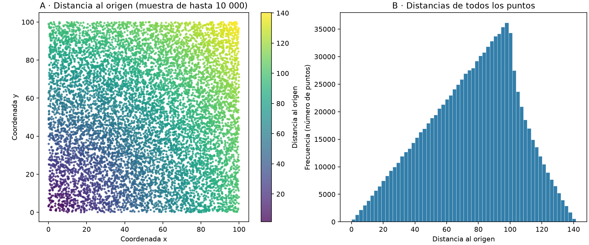

# Solución: distancias al origen con ciclos y vectores

## 1. Qué se calcula
Se generan 1 000 000 de puntos `(x[i], y[i])`, con coordenadas uniformes en `[0, 100)`, mediante `np.random.default_rng(42)`, tal como indica la plantilla. Se calcula la distancia de cada punto al origen, no la distancia entre pares de puntos.

Por el teorema de Pitágoras:

`d[i] = sqrt(x[i]² + y[i]²)`.

Por ejemplo, para `(3, 4)`, la distancia es `sqrt(9 + 16) = 5`. El resultado contiene un millón de distancias, en el mismo orden que los puntos originales.

## 2. Python con ciclos
```python
def distancias_for(x, y):
    N = len(x)
    distancias = np.zeros(N, dtype=np.float64)
    for i in range(N):
        distancias[i] = np.sqrt(x[i]**2 + y[i]**2)
    return distancias
```
Primero se reserva el arreglo de resultados. Después, el ciclo recorre las posiciones de 0 a N−1, obtiene las dos coordenadas, eleva ambas al cuadrado, suma y calcula la raíz cuadrada. Se conserva exactamente el código base.

## 3. Python con vectores
```python
def distancias_vectorizadas(x, y):
    return np.sqrt(x**2 + y**2)
```
`x**2` eleva cada coordenada x al cuadrado; `y**2` hace lo mismo con y. La suma combina elementos en la misma posición y `np.sqrt` calcula sus raíces. En la posición i se obtiene exactamente la misma fórmula matemática que con el ciclo.

La diferencia está en cómo se ejecuta: NumPy procesa los arreglos mediante rutinas compiladas y evita un millón de iteraciones gestionadas por Python. No se usa `np.vectorize` ni una función que ya calcule distancias. Esta vectorización no implica necesariamente varios núcleos ni requiere atribuir el cálculo a BLAS o LAPACK.

Ambas versiones requieren tiempo O(N) y un resultado de tamaño O(N). La expresión vectorizada crea arreglos temporales para cuadrados y suma. Cada arreglo float64 de un millón de elementos ocupa 8 MB (aproximadamente 7.63 MiB); no todos los temporales tienen que coexistir. La velocidad se obtiene a cambio de ese trabajo y memoria temporal adicionales.

## 4. Medición y validación
Se usa el mismo par de arreglos en ambas versiones. Primero se ejecuta una vez cada función para calentar. Después se realizan cinco mediciones por versión con `time.perf_counter()`, alternando el orden: ciclo/vector, vector/ciclo, etc.

El cronómetro incluye la reserva del resultado y los temporales dentro de cada función. La generación de datos, comprobaciones, impresiones y gráficas quedan fuera. Se usa la mediana para reducir la influencia de mediciones aisladas lentas.

Se comprobaron los casos `(0,0)`, `(3,4)`, `(6,8)`, `(0,5)`, `(0.3,0.4)`, `(5,12)` y los arreglos vacíos. Además, todas las mediciones del millón completo se validaron con `np.testing.assert_allclose`, `rtol=1e-12` y `atol=1e-12`. Se revisaron forma `(N,)`, tipo float64 y conservación de las entradas.

La comparación tolera diferencias pequeñas por redondeo: `abs(resultado - referencia) <= atol + rtol * abs(referencia)`.

| N | Mediana con ciclo (s) | Mediana vectorizada (s) | Aceleración |
|---:|---:|---:|---:|
| 1 000 000 | 0.384715 | 0.001283 | 299.85× |

La aceleración es `T_ciclo / T_vectorizado`. Estos son tiempos reales de esta ejecución, no valores garantizados para otros equipos.

Entorno: Python 3.12.14, NumPy 2.5.4, Matplotlib 3.11.2; macOS-26.6.2-arm64-arm-64bit, arquitectura arm64.

## 5. Gráfica
El panel A representa una muestra reproducible de 10 000 puntos. Se seleccionan los mismos índices para x, y y distancia. La escala de ambos ejes es igual para evitar deformar la geometría. Los puntos próximos al origen tienen menor distancia y los cercanos a `(100,100)` tienen mayor distancia.

El panel B usa las distancias de los 1 000 000 de puntos, no solo la muestra. Las frecuencias no son uniformes: distintas franjas de distancia ocupan distintas áreas dentro del cuadrado. Las distancias están entre 0 y un límite superior no incluido de `100*sqrt(2) ≈ 141.421`.



## 6. Pasarlo a MATLAB
En MATLAB los índices empiezan en 1. Se utilizan vectores fila y se preasigna el resultado del ciclo.

```matlab
function distancias = distancias_for(x, y)
    N = numel(x);
    distancias = zeros(1, N, 'double');
    for i = 1:N
        distancias(i) = sqrt(x(i)^2 + y(i)^2);
    end
end

function distancias = distancias_vectorizadas(x, y)
    distancias = sqrt(x.^2 + y.^2);
end
```

En el ciclo, `x(i)` es un escalar y puede usarse `^2`. En la versión vectorizada se necesita `.^2`, que eleva cada elemento al cuadrado; `^2` representa una potencia matricial. De igual forma, `.*` y `./` serían las operaciones elemento a elemento para multiplicación y división. La suma `+` ya opera elemento a elemento para vectores del mismo tamaño y `sqrt` también.

`solucion_matlab.m` importa `coordenadas.csv`, convierte sus columnas en vectores fila, comprueba casos pequeños y el millón completo, calienta ambos métodos y mide cinco repeticiones alternadas con `tic/toc`. Finalmente muestra la tabla, genera la gráfica y guarda `resultados_matlab.csv` y `distancias_matlab.png`.

El CSV conserva 17 cifras significativas para transferir los mismos float64. Usar la misma semilla en ambos lenguajes no garantiza las mismas coordenadas. La muestra para dibujar puede ser diferente entre lenguajes; cada muestra es reproducible y el cálculo siempre usa todos los puntos.

No se ejecutó MATLAB en este entorno, por lo que sus tiempos quedan por medir. Su compilador JIT puede optimizar mucho el ciclo: no debe suponerse que tendrá la misma aceleración que Python. Para comparar lenguajes, ejecútalos en el mismo equipo, con las mismas coordenadas y condiciones similares.

## 7. Cómo ejecutar
- Python: instala `numpy` y `matplotlib` con `python3 -m pip install numpy matplotlib`; luego ejecuta `python3 solucion_python.py`. También puedes abrir `solucion_python.ipynb` y ejecutar sus celdas en orden.
- MATLAB: coloca `solucion_matlab.m` y `coordenadas.csv` en la misma carpeta, abre el archivo `.m` y pulsa Run. El script localiza el CSV junto a sí mismo.

El script Python regenera la gráfica, el CSV y el archivo de resultados; la exportación queda fuera de los tiempos medidos.
